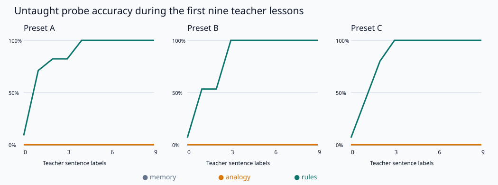

# Decipher Lab measured results

11 root anchors + 9 support sentences; 60 stream sentences; 30 disjoint never-taught probes. Pending labels are not drained.

All models receive the same root anchors, support labels, stream and feedback schedule. Probe answers are never released. Accuracy is exact structured meaning accuracy.

| Preset | Model | Roots only | After 1 support label | After 9 support labels | Final probe | Stream first guesses | Pending labels |
|---|---|---:|---:|---:|---:|---:|---:|
| A | memory | 0.0% | 0.0% | 0.0% | 0.0% | 0.0% | 3 |
| A | analogy | 0.0% | 0.0% | 0.0% | 0.0% | 0.0% | 3 |
| A | rules | 8.9% | 71.1% | 100.0% | 100.0% | 100.0% | 3 |
| B | memory | 0.0% | 0.0% | 0.0% | 0.0% | 0.0% | 3 |
| B | analogy | 0.0% | 0.0% | 0.0% | 0.0% | 0.0% | 3 |
| B | rules | 6.7% | 53.3% | 100.0% | 100.0% | 100.0% | 3 |
| C | memory | 0.0% | 0.0% | 0.0% | 0.0% | 0.0% | 3 |
| C | analogy | 0.0% | 0.0% | 0.0% | 0.0% | 0.0% | 3 |
| C | rules | 6.7% | 43.3% | 100.0% | 100.0% | 100.0% | 3 |

| Preset | Model | Normalized learning AUC | Mean prediction call (ms) | Mean feedback call (ms) |
|---|---|---:|---:|---:|
| A | memory | 0.000 | 0.006 | 0.003 |
| A | analogy | 0.000 | 0.133 | 0.003 |
| A | rules | 0.983 | 0.249 | 0.003 |
| B | memory | 0.000 | 0.006 | 0.003 |
| B | analogy | 0.000 | 0.137 | 0.003 |
| B | rules | 0.979 | 0.234 | 0.004 |
| C | memory | 0.000 | 0.006 | 0.003 |
| C | analogy | 0.000 | 0.145 | 0.003 |
| C | rules | 0.981 | 0.176 | 0.004 |

AUC integrates the combined support and stream probe curve against arrived teacher-answer count, normalized by the observed answer-budget range. Prediction-call timing includes feedback due at that input step; feedback-call timing includes queuing or immediate updates. These short CPU timings are diagnostics, not a benchmark.

Results average three deterministic randomized lexicons per preset. Support lessons use immediate feedback; the configured delay applies to the stream. Pending answers are not drained. The support budget is separate from the stream-label budget.

This regular synthetic task becomes easy quickly. Exact memory is weak on disjoint probes; nearest-example copying is a stronger spelling baseline but cannot construct a new structured meaning. Nine generated languages are a demonstration, not evidence of arbitrary language decipherment. The chart uses support labels to expose the early learning transition; stream curves remain in the JSON report.
